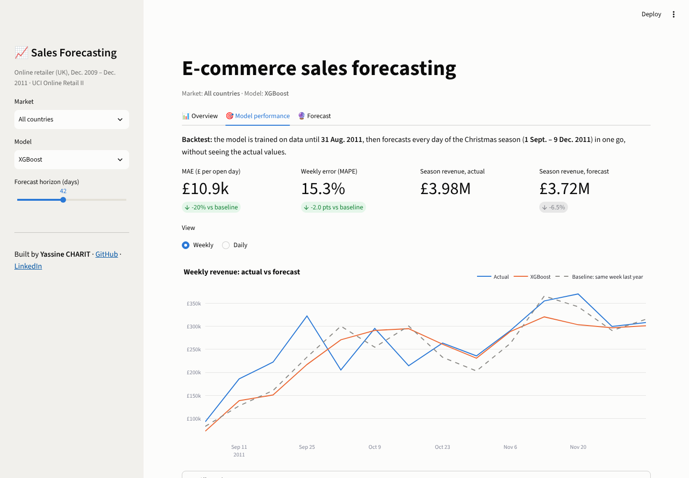
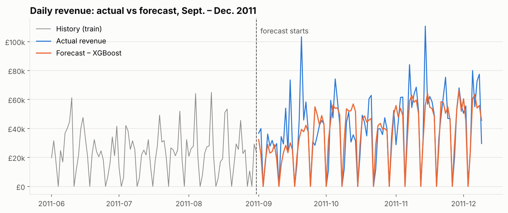
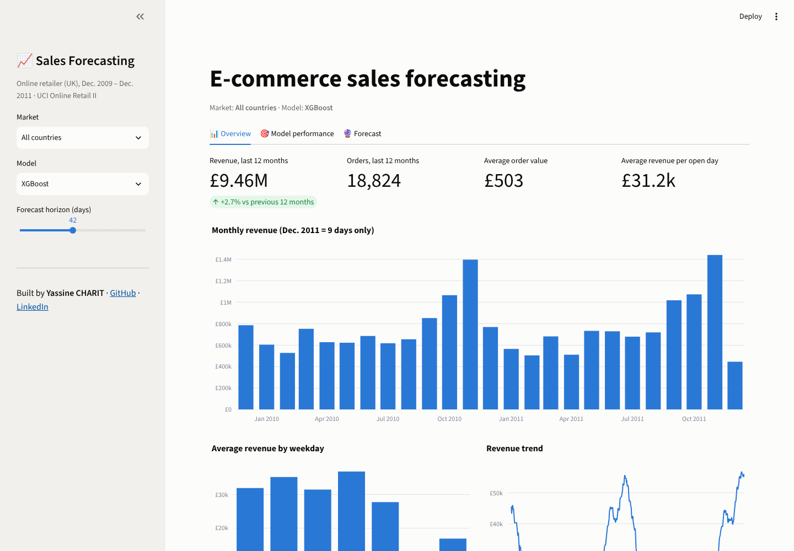
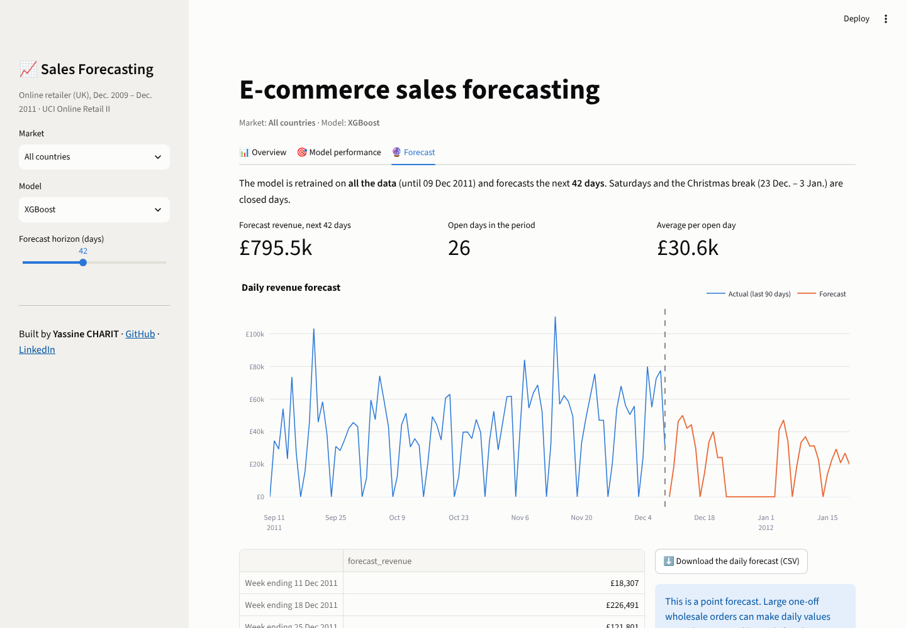

# 📈 E-commerce Sales Forecasting


Forecasting the daily revenue of an online retailer with machine learning, and showing the forecasts in an interactive Streamlit app.

Live demo: https://ecommerce-sales-forecasting-yc.streamlit.app/ (the app sleeps when nobody uses it, it can take around 30 seconds to wake up)



## Context

During my internship at Talentum Consulting I built a sales forecasting model and a Streamlit interface for an e-commerce client. The client data was confidential, so I rebuilt the whole project on a public dataset to be able to show the method and the code.

The dataset is [Online Retail II](https://archive.ics.uci.edu/dataset/502/online+retail+ii) from the UCI Machine Learning Repository: every invoice line of a UK online shop that sells gifts and decoration, mostly to wholesalers, from December 2009 to December 2011. That is about 1 million lines with the invoice number, product, quantity, unit price, date and time, customer ID and country.

The business question: at the end of August, how much revenue will the company make each day of the Christmas season? A good forecast helps plan stock, warehouse staff and cash.

The project has 3 parts: cleaning and exploring the data, comparing forecasting models, and an app to use the results.

## 1. Data cleaning and exploration

Notebook: [`notebooks/01_eda.ipynb`](notebooks/01_eda.ipynb), code: [`src/data_prep.py`](src/data_prep.py)

### Cleaning

Each cleaning step is logged in a data quality report ([`reports/data_quality.csv`](reports/data_quality.csv)). From 1,067,371 raw lines, 996,488 are kept (93.4%).

| Step | Lines removed |
|---|---|
| Exact duplicates | 34,335 |
| Cancellation lines (invoices starting with "C") | 19,104 |
| Purchases cancelled afterwards | 7,067 |

The other steps remove the accounting adjustments (invoices starting with "A"), the lines that are not product sales (postage, bank fees, discounts, gift vouchers, tests) and the lines with a quantity or a price equal to zero or negative. The exact count of each step is in the report.

The most interesting step was the purchases cancelled afterwards. Removing the cancellation lines is not enough: the original purchase stays in the data. I match each cancellation with the purchase it cancels using the customer, the product and the quantity. Without this, an order of 80,995 units that was cancelled a few minutes later creates a huge fake peak in the revenue.

About 22.8% of the lines have no customer ID. They are real sales, so I kept them for the revenue, but not for the customer analysis.

### What the data shows

- **£19.1M of revenue**, 39,227 orders, 5,833 identified customers, 4,886 products and 43 countries.
- **Strong seasonality.** Sales are stable from January to August, then rise until a peak in November, which is about twice a normal month: wholesalers order for Christmas.
- **A B2B rhythm.** There are no sales on Saturdays, Thursday is the best day, and orders are placed during office hours with a peak around noon.
- **One main market.** The UK makes 85.4% of the revenue, far ahead of Ireland, the Netherlands, Germany and France.
- **Concentration.** 21% of the products make 80% of the revenue, and the top 20% of customers make 77% of the identified revenue.

These findings decided the modelling choices: forecast the total daily revenue (too much noise per product), and give the model the calendar, the closed days and the approach of Christmas.

## 2. Forecasting models

Notebook: [`notebooks/02_forecasting.ipynb`](notebooks/02_forecasting.ipynb), code: [`src/forecasting.py`](src/forecasting.py)

### Scenario

The models are trained on the data from December 2009 to August 2011, then they forecast every day from 1 September to 9 December 2011 in one go: 100 days and £4.0M of revenue, the hardest and most important period of the year.

The models that use past sales are run recursively: each day's forecast is used as input for the next days, because in real life the future values are not known. This is more realistic, and harder, than forecasting one day ahead with the real values.

### Features

| Family | Features | Why |
|---|---|---|
| Calendar | day of the week, month, day and week of the year, yearly sine and cosine | weekly and yearly seasonality |
| Events | days before Christmas, UK bank holidays, closed days (Saturdays and the Christmas break) | the Christmas peak and the days without sales |
| Recent level | revenue 1, 7, 14 and 28 days before, 7-day and 28-day rolling means of the open days | the current trend |

### Results

4 approaches are compared, from the simplest to the most complex:

| Model | MAE (£ per day) | RMSE | Daily error | Weekly error | Error on the season total |
|---|---|---|---|---|---|
| XGBoost | 10,877 | 15,556 | 27.1% | 15.3% | -6.5% |
| Random Forest | 11,252 | 16,019 | 25.6% | 16.2% | -10.2% |
| Linear regression (Ridge) | 13,319 | 18,390 | 27.0% | 20.0% | -22.2% |
| Same weekday last year (baseline) | 13,656 | 18,387 | 34.6% | 17.3% | -5.6% |

The errors are computed on the open days only, since every model gets the closed days right.

What the results mean:
- **XGBoost is the best model.** It cuts the daily error (MAE) by 20% compared to the baseline, and is about 15% off per week, which is good enough to plan stock and staff.
- **The baseline is strong.** Taking the same weekday one year earlier already works well because the business is very seasonal. That's why I always compare a model to a simple baseline: beating it is the real test.
- **The linear model misses the November surge** and underestimates the season by 22%, because the relation between the calendar and the revenue is not linear.
- **Daily errors stay high** because of big one-off wholesale orders that no calendar can predict. For decisions, the weekly level is the one to use.

The most important features for XGBoost are the closed days, the day of the week, the bank holidays, the level of the last 7 days and the distance to Christmas.



### Limits

- Only 2 years of history, so the model has learned from a single previous Christmas.
- No external data (promotions, prices, marketing campaigns).
- No uncertainty range: the forecast is a single number per day.

## 3. The Streamlit app

Code: [`app/app.py`](app/app.py)

The app has 3 tabs:

| Tab | Content |
|---|---|
| Overview | revenue, orders and average order value over the last 12 months with the growth, monthly revenue, average revenue per weekday, 28-day trend |
| Model performance | the test on the Christmas season for the chosen market and model, compared to the baseline, with weekly or daily charts and all the metrics |
| Forecast | the model retrained on all the data, a forecast for the next 7 to 90 days, weekly totals and a CSV download |

In the sidebar you choose the market (all countries, UK, Ireland, Netherlands, Germany, France), the model (XGBoost, Random Forest or Ridge) and the forecast horizon. For the small markets, the app shows a warning: with only a few orders per week, the forecast is much less reliable.

| Overview | Forecast |
|---|---|
|  |  |

## Run it

```bash
git clone https://github.com/Yassinech12/ecommerce-sales-forecasting.git
cd ecommerce-sales-forecasting
pip install -r requirements.txt

python src/download_data.py      # downloads the raw data (45 MB) into data/raw/
python src/data_prep.py          # cleaning, creates the files in data/processed/
jupyter notebook notebooks/      # 01_eda.ipynb, then 02_forecasting.ipynb
streamlit run app/app.py
```

The raw data is not in the repository because it is too big for GitHub, but the app only needs the processed files, which are included.

## Repository structure

```
ecommerce-sales-forecasting/
├── app/              Streamlit app
├── data/processed/   clean daily sales, total and by country
├── docs/images/      app screenshots
├── notebooks/        01_eda.ipynb, 02_forecasting.ipynb
├── reports/          charts, metrics and data quality report
└── src/              download, cleaning, features, models and chart style
```

## Tech stack

Python, Pandas, NumPy, scikit-learn, XGBoost, Matplotlib, Plotly, Streamlit, Jupyter. The app is deployed on Streamlit Community Cloud.

## Next steps

- forecast by country or by product category
- add an uncertainty range with quantile regression
- try other models such as LightGBM or Prophet
- retrain the model every month with the new data

---

Yassine CHARIT · [LinkedIn](https://www.linkedin.com/in/yassine-charit/) · [GitHub](https://github.com/Yassinech12) · Data: [UCI Machine Learning Repository](https://archive.ics.uci.edu/dataset/502/online+retail+ii)
---
**Author:** Yassine CHARIT · [LinkedIn](https://www.linkedin.com/in/yassine-charit/) · Data source: [UCI Machine Learning Repository](https://archive.ics.uci.edu/dataset/502/online+retail+ii)
